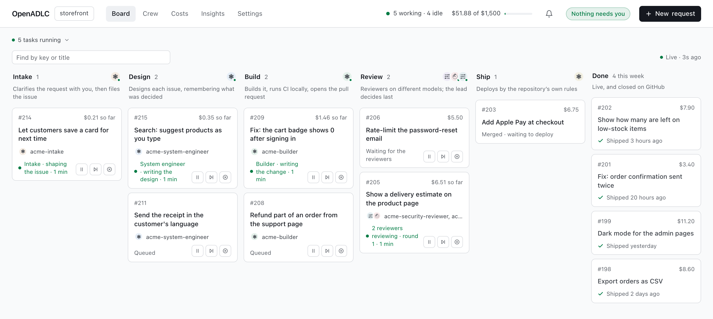
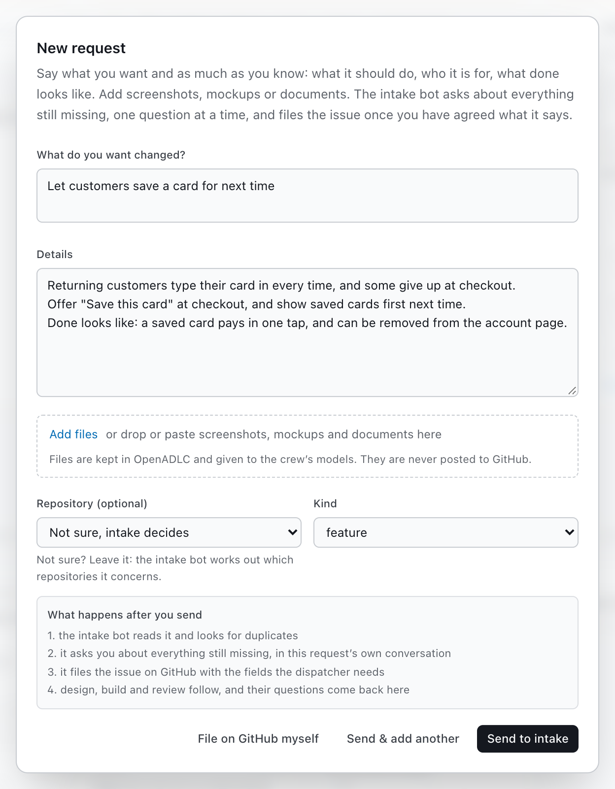
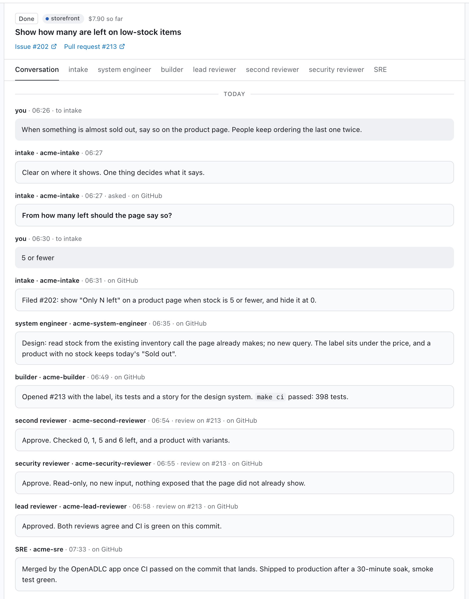

<h1 align="center">OpenADLC</h1>

<p align="center">
  <b>Ask for a change in plain words. An AI crew asks you what's missing, builds it, has three reviewers on more than one model provider check it, and merges and ships it by your repository's rules.</b>
</p>

<p align="center">You answer questions; you don't babysit. It runs on your machines or your cloud, on your GitHub.</p>

<p align="center"><b>Your models, your choice:</b> an API key, or the Claude, ChatGPT or Grok subscription you already pay for.</p>

<p align="center">
  <a href="https://github.com/620legal/OpenADLC/releases"></a>
  <a href="https://github.com/620legal/OpenADLC/actions/workflows/ci.yml"></a>
  <a href="LICENSE"></a>
</p>

<p align="center">
  <a href="#quick-start"><b>Quick start</b></a> ·
  <a href="#one-change-from-request-to-release"><b>Follow one change</b></a> ·
  <a href="docs/architecture.md">How it works</a> ·
  <a href="docs/security.md">Security</a>
</p>

<picture>
  <source media="(prefers-color-scheme: dark)" srcset="docs/images/board-dark.png">
  
</picture>

<table>
  <tr>
    <td align="center" width="25%"><h3>61 of 76</h3>pull requests merged here, 26 Oct – 11 Nov 2026, were <a href="https://github.com/620legal/OpenADLC/pulls?q=is%3Apr+is%3Amerged+author%3Afleet-atlas-orzelig">built by its own crew</a></td>
    <td align="center" width="25%"><h3>51 minutes</h3>from issue to merge for <a href="#one-change-from-request-to-release">one real change</a></td>
    <td align="center" width="25%"><h3>$41.86</h3>of model use for that change, at API list prices</td>
    <td align="center" width="25%"><h3>4 touches</h3>were the person's part: the request, one answer, one OK, the release</td>
  </tr>
</table>

## How it works

1. **You ask.** A sentence or a page, with screenshots if you have them.
2. **The crew asks you back** when a decision is yours: on the board, under Needs you, or as a push to your phone. The rest it decides, and says why.
3. **It ships.** A designer, a builder that runs your CI until it's green, and reviewers on more than one model provider. The lead approves, OpenADLC's GitHub App merges, and your repository's rules deploy.

<table>
  <tr>
    <td width="50%">
      <picture>
        <source media="(prefers-color-scheme: dark)" srcset="docs/images/request-dark.png">
        
      </picture>
    </td>
    <td width="50%">
      <picture>
        <source media="(prefers-color-scheme: dark)" srcset="docs/images/item-dark.png">
        
      </picture>
    </td>
  </tr>
  <tr>
    <td align="center"><sub>Ask for anything, with files attached</sub></td>
    <td align="center"><sub>Each change is one conversation, from the request to production</sub></td>
  </tr>
</table>

<p align="center"><sub>Screenshots from a demo install, with an invented shop as its project.</sub></p>

## One change, from request to release

A real change from this repository. A pull request had sat for 21 hours because its builder was too busy for the round that would fix it, and nothing said so.

| Step | Who | On GitHub |
|---|---|---|
| **Request** | A person: start a round the builder was too busy for as soon as it has room | [#273](https://github.com/620legal/OpenADLC/issues/273) |
| **Intake** | Asks one question, then rewrites the issue for the person's OK | [#273](https://github.com/620legal/OpenADLC/issues/273) |
| **Design** | system-engineer: where the round is turned away, and what records it | [design](https://github.com/620legal/OpenADLC/issues/273#issuecomment-6777162208) |
| **Build** | builder: the change, its tests, `make ci` green | [#278](https://github.com/620legal/OpenADLC/pull/278) |
| **Review** | Second and security reviewers advise; the lead asks for one change, then approves | [second](https://github.com/620legal/OpenADLC/pull/278#pullrequestreview-5848303309) · [security](https://github.com/620legal/OpenADLC/pull/278#pullrequestreview-5848324164) · [lead](https://github.com/620legal/OpenADLC/pull/278#pullrequestreview-5848600966) |
| **Merge** | The GitHub App, once CI passed on the commit that lands | [b81e460](https://github.com/620legal/OpenADLC/commit/b81e460) |
| **Release** | A person cuts it | [v0.1.29](https://github.com/620legal/OpenADLC/releases/tag/v0.1.29) |

## Quick start

**On a laptop** (macOS, Linux, or Windows with WSL 2):

```bash
curl -fsSL https://raw.githubusercontent.com/620legal/OpenADLC/main/infra/local/install.sh | bash
```

It lists what the machine is missing and asks before installing anything. Then it starts OpenADLC and opens the console. The console walks you through the rest and checks each step: a GitHub App, the crew's GitHub accounts, a model account (Anthropic, OpenAI or xAI) and a repository. Then press **New request**.

**In Google Cloud** (Cloud Run, Cloud SQL, and IAP in front of the console):

```bash
curl -fsSL https://raw.githubusercontent.com/620legal/OpenADLC/main/infra/gcp/install.sh | bash -s -- --project my-openadlc
```

**Your models, your choice.** Connect an API key, or sign in with a Claude, ChatGPT or Grok subscription you already have, from the console; each seat can use either. A subscription runs under its provider's consumer terms, so check them first ([Subscriptions](docs/self-hosting.md#subscriptions)).

Prerequisites, the step-by-step install and the cloud's options are in [Self-hosting](docs/self-hosting.md).

## The crew

- **intake** asks what's missing and files the issue
- **system engineer** designs, and remembers what was decided
- **builder** implements, runs CI until it's green, and opens the pull request
- **lead, second and security reviewers**, on more than one model provider by default; the lead decides
- **SRE** and **QA** watch the deploy and the user journeys

Each seat has its own model (Claude, OpenAI Codex or xAI Grok by default), on an API key or a subscription; change them on the Crew page.

## Safe by design

This is how OpenADLC is built to behave, not a guarantee. What hasn't been seen working yet is listed by name in [the unverified log](docs/unverified.md).

- **Agents don't merge.** The GitHub App merges, once the lead reviewer has approved that commit and CI has passed on it. Where GitHub's plan can't enforce that, a bot's merge is caught and its deploy is held ([how](docs/security.md#the-platform)).
- **Agents don't approve a deploy.** Your GitHub environment releases production: a person you name, or a soak timer with an automatic rollback.
- **Spend is capped.** An API key is capped per task and per month, and a subscription run has a runaway guard; a cap stops the work and asks you ([how](docs/security.md#spend-caps)).
- **Each task runs in its own container** (the `docker` driver), with a GitHub token that expires in hours. On the Google Cloud install ([`infra/gcp`](infra/gcp)), a task reaches only GitHub, package registries and its model. A laptop install doesn't restrict where a task connects.
- **Prompt injection is assumed.** Agents act only for people with access to the repository, and read only what those people wrote.
- **You stay responsible** for what ships. Your reviews, checks and approvers decide what is correct.

The details are in the [security model](docs/security.md).

## More

[Architecture](docs/architecture.md) · [Self-hosting](docs/self-hosting.md) · [Configuration](docs/configuration.md) · [CLI](docs/cli.md) · [Security](docs/security.md) · [Troubleshooting](docs/troubleshooting.md) · [Developing](docs/development.md) · [Extending](docs/extending.md) · [Releases](https://github.com/620legal/OpenADLC/releases)

OpenADLC is at 0.1.x and releases several times a week. 620 Legal builds its software with it, this repository included. To contribute, file an issue and the crew picks it up (see [CONTRIBUTING](.github/CONTRIBUTING.md)). Report security issues privately ([SECURITY](.github/SECURITY.md)).

<sub>Apache-2.0: see [LICENSE](LICENSE), [NOTICE](NOTICE) and the [trademark policy](docs/trademarks.md). The files OpenADLC adds to your repository are also offered under 0BSD ([crew/templates/LICENSE](crew/templates/LICENSE)). OpenADLC is provided "as is", without warranty of any kind. Nothing here is legal advice. That its publisher is named 620 Legal does not mean OpenADLC, or anything it builds, has been reviewed for compliance with any law or any third party's terms.</sub>
